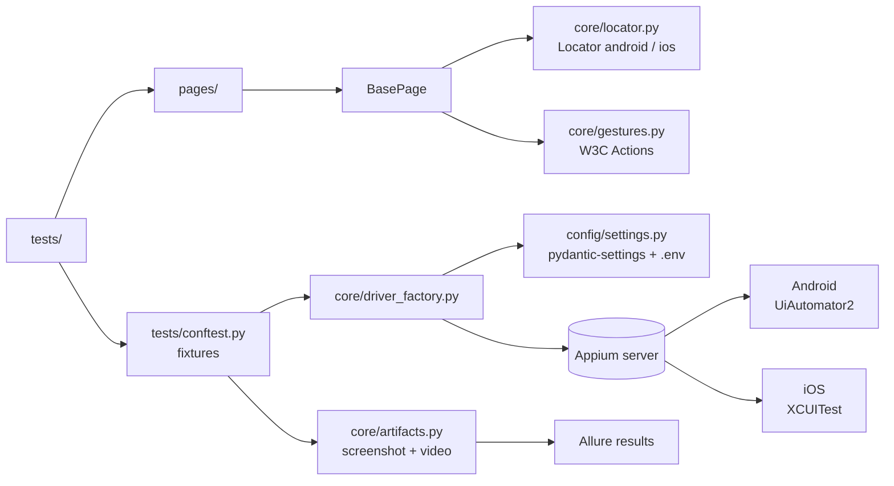

# appium-mobile-framework

> Cross-platform mobile test automation framework (Android + iOS) built with **Python**, **Appium 2+**, **Pytest** and **Allure**, targeting the **Sauce Labs My Demo App**.

---
[](https://github.com/Rachdi-imen/appium-mobile-framework/actions)


---

## Table of contents

1. [Goals](#goals)
2. [Tech stack](#tech-stack)
3. [Project status](#project-status)
4. [Architecture](#architecture)
5. [Project structure](#project-structure)
6. [Environment setup (Windows)](#environment-setup-windows)
7. [Quick start](#quick-start)
8. [Configuration](#configuration)
9. [Running tests](#running-tests)
10. [Cross-platform Page Object Model](#cross-platform-page-object-model)
11. [Test scenarios](#test-scenarios)
12. [Observability and Allure Report](#observability-and-allure-report)
13. [Cloud execution](#cloud-execution)
14. [CI/CD](#cicd)
15. [Conventions](#conventions)
16. [Troubleshooting](#troubleshooting)
17. [License](#license)

---

## Goals

This project is a portfolio showcase of current industry standards in mobile test automation:

- Modern **Appium 2+** sessions built from typed options (`UiAutomator2Options`, `XCUITestOptions`), with **no deprecated API** (`TouchAction` / `MultiAction` are never used; every gesture is a **W3C Action**).
- One **Page Object Model** shared by Android and iOS, with no duplicated business logic.
- Strictly typed Python (type hints, `mypy`, `ruff`).
- Reproducible runs: local emulator, cloud device farm, and CI.
- Rich failure diagnostics: screenshots and screen recordings attached to the Allure report.

## Tech stack

| Area | Tool |
|------|------|
| Language | Python 3.11+ |
| Mobile automation | Appium 2+ with `Appium-Python-Client` 5.x |
| Android driver | UiAutomator2 |
| iOS driver | XCUITest (macOS or cloud only) |
| Test runner | Pytest + `pytest-xdist` |
| Reporting | `allure-pytest` |
| Configuration | `pydantic-settings` + `.env` |
| Lint / typing | `ruff`, `mypy` |
| CI | GitHub Actions |
| App under test | [Sauce Labs My Demo App](https://github.com/saucelabs/my-demo-app-android) (native Android / iOS) |

## Project status

This table is the living roadmap of the project. Update it as each step is completed.

| # | Step | Status |
|---|------|--------|
| 1 | Local environment (Python, Node, Appium, UiAutomator2, Android SDK, emulator) | Done |
| 2 | Appium server running and Android app installed on the emulator | Done |
| 3 | `requirements.txt`, `pytest.ini` | To do |
| 4 | `config/settings.py` and `.env.example` | To do |
| 5 | `core/driver_factory.py` (local + cloud) | To do |
| 6 | `tests/conftest.py` (driver lifecycle, screenshots, video) | To do |
| 7 | `core/locator.py` and `pages/base_page.py` | To do |
| 8 | Page objects (login, catalog, product, cart, checkout, drawing) | To do |
| 9 | Locators inspected with Appium Inspector (Android, then iOS) | To do |
| 10 | Tests: E2E, W3C gestures, data-driven login | To do |
| 11 | CI workflow (`ruff` + Android emulator) | To do |
| 12 | iOS run on a cloud provider | To do |
| 13 | Final README polish (badges, screenshots, Allure sample) | To do |

## Architecture



**Layers and responsibilities**

- `config/`: a single typed source of truth for every runtime option.
- `core/`: framework plumbing (driver, locators, gestures, artifacts). Knows nothing about the app.
- `pages/`: app knowledge (screens and user actions). Knows nothing about Pytest.
- `tests/`: scenarios and fixtures. Contains no locators and no Appium calls.

## Project structure

```
appium-mobile-framework/
├── .github/
│   └── workflows/
│       └── ci.yml
├── apps/
│   ├── .gitkeep
│   └── README.md                  # where to download the app binaries
├── config/
│   ├── __init__.py
│   └── settings.py
├── core/
│   ├── __init__.py
│   ├── enums.py                   # Platform, ExecutionMode
│   ├── locator.py                 # cross-platform Locator
│   ├── driver_factory.py
│   ├── gestures.py                # W3C Actions: swipe, scroll, drawing
│   └── artifacts.py               # screenshots, video, Allure attachments
├── pages/
│   ├── __init__.py
│   ├── base_page.py
│   ├── login_page.py
│   ├── catalog_page.py
│   ├── product_page.py
│   ├── cart_page.py
│   ├── checkout_page.py
│   ├── menu_page.py
│   └── drawing_page.py
├── tests/
│   ├── __init__.py
│   ├── conftest.py
│   ├── data/
│   │   ├── __init__.py
│   │   └── login_cases.py
│   ├── test_checkout_e2e.py
│   ├── test_gestures_w3c.py
│   └── test_login_data_driven.py
├── docs/
│   └── architecture.md
├── .env.example
├── .gitignore
├── LICENSE
├── Makefile
├── README.md
├── pyproject.toml                 # ruff + mypy configuration
├── pytest.ini
└── requirements.txt
```

## Environment setup (Windows)

Everything below is done once per machine. Commands are for **PowerShell**.

### 1. Python 3.11 or newer

Install from [python.org](https://www.python.org/downloads/) and tick **"Add python.exe to PATH"** and the **py launcher** option. Check with:

```powershell
py -0
```

### 2. Node.js (LTS) and Appium

```powershell
node --version
npm install -g appium
appium --version
```

### 3. Appium driver

```powershell
appium driver install uiautomator2
appium driver list --installed
```

The iOS driver (`xcuitest`) requires macOS with Xcode. On Windows, iOS runs go through a cloud provider (see [Cloud execution](#cloud-execution)).

### 4. Android Studio, SDK and emulator

1. Install Android Studio (Standard setup, with the Android SDK).
2. In **Device Manager**, create a **Pixel 8 / API 34 (Google APIs, x86_64)** virtual device.
3. Start the emulator and wait for the Android home screen.

### 5. Environment variables

```powershell
[Environment]::SetEnvironmentVariable("ANDROID_HOME", "$env:LOCALAPPDATA\Android\Sdk", "User")
[Environment]::SetEnvironmentVariable("JAVA_HOME", "<path to your JDK>", "User")
```

Add `%ANDROID_HOME%\platform-tools` to your user `Path`, then **open a new terminal**.

### 6. Verify the toolchain

```powershell
echo $env:ANDROID_HOME
echo $env:JAVA_HOME
adb devices                          # must list: emulator-5554   device
appium driver doctor uiautomator2    # 0 required fixes expected
```

`bundletool`, `ffmpeg` and `gstreamer` reported by the doctor are optional and not needed for this project.

### 7. Application under test

The project targets the **native** Sauce Labs My Demo App.

| Platform | Source | Identifier |
|----------|--------|-----------|
| Android | [my-demo-app-android releases](https://github.com/saucelabs/my-demo-app-android/releases) (`mda-2.3.0-27.apk`) | `com.saucelabs.mydemoapp.android` |
| iOS | [my-demo-app-ios releases](https://github.com/saucelabs/my-demo-app-ios/releases) | `com.saucelabs.mydemo.app.ios` |

> Not to be confused with the **React Native** variant (`com.saucelabs.mydemoapp.rn`), which is a different project with different locators.

Place the Android binary in `apps/` as `android-mydemoapp.apk`, then install it:

```powershell
adb install apps\android-mydemoapp.apk
adb shell pm list packages | findstr saucelabs
```

## Quick start

```powershell
git clone https://github.com/Rachdi-imen/appium-mobile-framework.git
cd appium-mobile-framework

py -3.12 -m venv .venv
.venv\Scripts\Activate.ps1
python -m pip install --upgrade pip
pip install -r requirements.txt

copy .env.example .env
```

In a **separate terminal**, keep the Appium server running:

```powershell
appium
```

Then, with the emulator started:

```powershell
pytest
```

## Configuration

All options are read from environment variables or a `.env` file (see `.env.example`) and validated at startup by `pydantic-settings`.

| Variable | Default | Description |
|----------|---------|-------------|
| `PLATFORM` | `android` | `android` or `ios` |
| `EXECUTION_MODE` | `local` | `local`, `browserstack` or `saucelabs` |
| `APPIUM_SERVER_URL` | `http://127.0.0.1:4723` | Local Appium endpoint |
| `EXPLICIT_WAIT_TIMEOUT` | `15` | Seconds for explicit waits |
| `ANDROID_DEVICE_NAME` | `Android Emulator` | Local device name |
| `ANDROID_APP_PATH` | `apps/android-mydemoapp.apk` | Local APK |
| `ANDROID_APP_PACKAGE` | `com.saucelabs.mydemoapp.android` | Android package |
| `IOS_BUNDLE_ID` | `com.saucelabs.mydemo.app.ios` | iOS bundle id |
| `RECORD_VIDEO` | `true` | Record screen during tests |

Cloud credentials (`BROWSERSTACK_*`, `SAUCELABS_*`) are only required when the matching `EXECUTION_MODE` is selected. Missing variables fail fast with an explicit error. Secrets are stored as `SecretStr` and never printed in logs.

> Never commit `.env`. Only `.env.example` is versioned.

## Running tests

```powershell
# Whole suite on the local Android emulator
pytest

# One scenario
pytest tests/test_login_data_driven.py

# By marker
pytest -m smoke
pytest -m "e2e and android"

# Parallel (one worker per available device)
pytest -n 2
```

> Parallel execution needs **one device per worker** (for example two emulators on different ports, or several cloud devices). Running two workers on a single emulator would make them interfere with each other.

## Cross-platform Page Object Model

Android and iOS locators are declared **once**, side by side, in each page. The base page picks the right one at runtime from the driver's platform, so page logic is never duplicated.

```python
# Illustrative design, final locators come from Appium Inspector
from appium.webdriver.common.appiumby import AppiumBy
from core.locator import Locator


class LoginPage(BasePage):
    USERNAME = Locator(
        android=(AppiumBy.ACCESSIBILITY_ID, "<android id>"),
        ios=(AppiumBy.ACCESSIBILITY_ID, "<ios id>"),
    )

    def login(self, username: str, password: str) -> None:
        self.type(self.USERNAME, username)
        ...
```

Rules:

- Tests call page methods only. They never touch locators or the driver directly.
- Explicit waits only. No `time.sleep`.
- Every gesture goes through `core/gestures.py` (W3C Actions).

## Test scenarios

| Test | Marker | What it demonstrates |
|------|--------|----------------------|
| `test_checkout_e2e.py` | `e2e`, `smoke` | Login, product selection with dynamic scroll, add to cart, checkout |
| `test_gestures_w3c.py` | `gestures` | Horizontal swipe to remove a cart item, geometric drawing on the Drawing screen |
| `test_login_data_driven.py` | `data_driven` | `@pytest.mark.parametrize` with passing and failing login cases |

> The Drawing screen and the swipe-to-delete behaviour must be confirmed in the native app during the inspection step.

## Observability and Allure Report

- The driver lifecycle is handled by Pytest fixtures in `tests/conftest.py`.
- Screen recording starts with `start_recording_screen` and is **kept only on failure**.
- On failure, a screenshot and the video are attached automatically to the Allure report.

Results are written to `reports/allure-results` on each run. To view the report, install the Allure CLI (it requires Java):

```powershell
npm install -g allure-commandline
allure serve reports/allure-results
```

## Cloud execution

Switch provider with environment variables only, with no code change:

```powershell
$env:EXECUTION_MODE = "browserstack"
pytest
```

- **Android and iOS** can both run on BrowserStack or Sauce Labs.
- **iOS cannot run locally on Windows**, because XCUITest requires macOS and Xcode. Use a cloud provider.
- Credentials and the uploaded app reference are provided through `.env` (see `.env.example`).

## CI/CD

The GitHub Actions workflow (`.github/workflows/ci.yml`) runs on each push and pull request:

1. **Lint job**: `ruff check` and `ruff format --check`, plus `mypy`.
2. **Test job**: starts an Android emulator, launches Appium, runs the suite, and uploads the Allure results as an artifact.

## Conventions

- Python 3.11+, strict type hints, PEP 8, formatted and linted by `ruff`.
- Deprecated Appium APIs are forbidden. `pytest.ini` turns Appium `DeprecationWarning` into errors.
- Branches: `main` is always green. Work happens on feature branches with pull requests.
- Commit messages: [Conventional Commits](https://www.conventionalcommits.org/) (`feat:`, `fix:`, `docs:`, `test:`, `ci:`).
- Never commit `.env`, `reports/`, `.venv/` or app binaries.

Suggested `.gitignore` entries:

```
.venv/
.env
reports/
apps/*.apk
apps/*.ipa
apps/*.zip
__pycache__/
.pytest_cache/
.mypy_cache/
.ruff_cache/
```

## Troubleshooting

| Symptom | Likely cause and fix |
|---------|----------------------|
| `adb devices` is empty | The emulator is not running or not fully booted. Start it and wait for the home screen. |
| `adb` not recognized | `platform-tools` is missing from `Path`, or the terminal was not reopened after editing it. |
| `adb server version doesn't match` | Two SDKs are present in `Path`. Keep a single `platform-tools` folder. |
| `py` not recognized | The Python launcher is missing. Reinstall Python and tick the launcher option. |
| `python -0` fails | Use `py -0` (the launcher), not `python`. |
| `ImportError: StrEnum` | The venv uses Python older than 3.11. Recreate it with `py -3.12 -m venv .venv`. |
| Port 4723 already in use | Another Appium instance is running. Stop it or change `APPIUM_SERVER_URL`. |
| Locators not found | You are testing the wrong app variant (native vs React Native). Check the package with `adb shell pm list packages`. |
| Corrupted Python folder (no `python.exe`) | Reinstall Python cleanly and recreate the venv. |

## License

Released under the [MIT License](LICENSE).